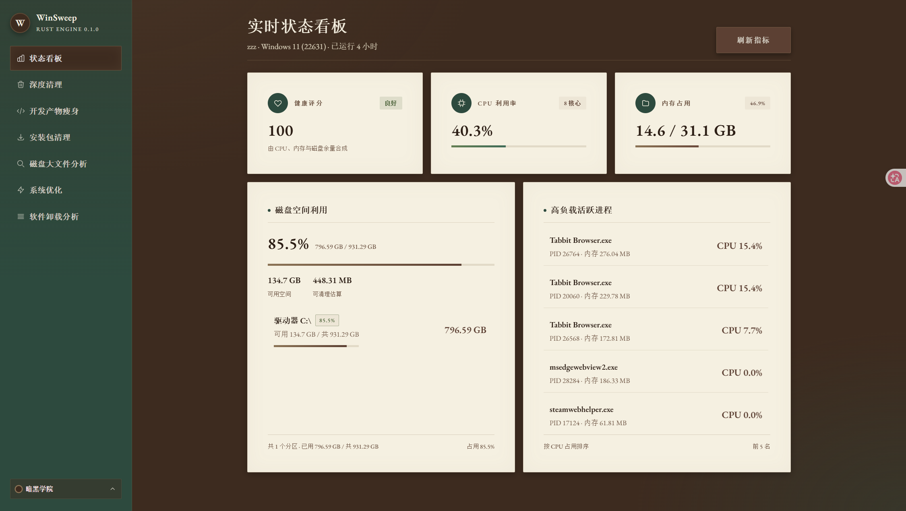
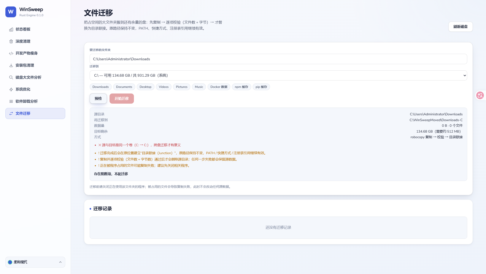
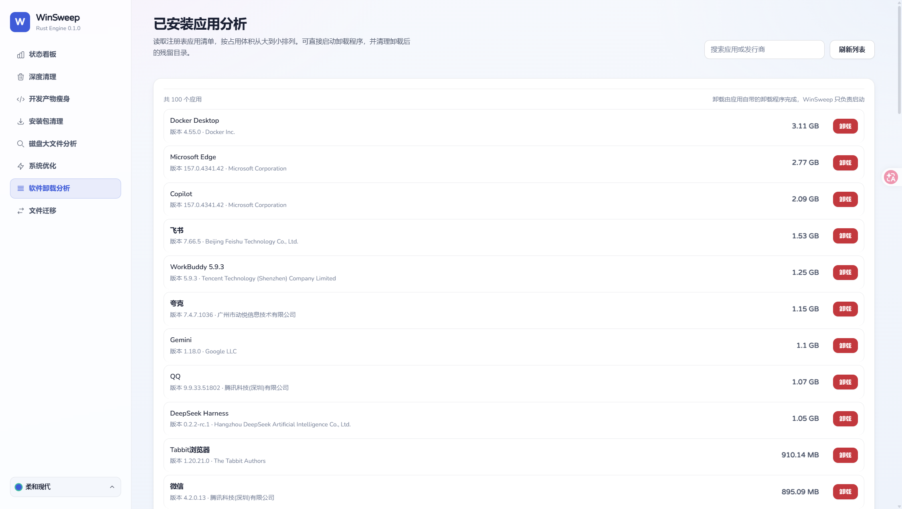

# WinSweep

> **Windows 深度清理、系统优化、磁盘分析与安全迁移工具**
>
> 纯 Rust 实现 · 单文件可执行（约 4.8 MB）· 自带本地 Web GUI · 零外部运行时

WinSweep 是一个面向 Windows 10/11 的系统维护工具，灵感来自 macOS 上的 [tw93/Mole](https://github.com/tw93/Mole)，
但**从界面到实现全部原创重写**，并针对 Windows 的实际痛点（C 盘爆满、残留启动项、开发者缓存、软件卸载残留）做了强化。

两种使用方式：**命令行**（适合脚本 / Agent 自动化）与**本地 Web GUI**（适合人工操作）。

[](https://www.npmjs.com/package/winsweep)
[](https://www.npmjs.com/package/winsweep)
[](LICENSE)
[](https://github.com/12zrr23/winsweep/releases)

```text
版本 0.1.0   ·   Rust 1.99 / edition 2024   ·   仅 Windows   ·   GUI 默认 http://127.0.0.1:41234
```

---

## 目录

1. [这是什么](#1-这是什么)
2. [功能一览](#2-功能一览)
3. [界面预览](#3-界面预览)
4. [快速开始](#4-快速开始)
5. [图形界面（GUI）](#5-图形界面gui)
6. [命令行（CLI）](#6-命令行cli)
7. [HTTP API](#7-http-api)
8. [安全设计](#8-安全设计)
9. [主题系统](#9-主题系统)
10. [项目结构](#10-项目结构)
11. [数据与配置](#11-数据与配置)
12. [构建与测试](#12-构建与测试)
13. [已知限制与排障](#13-已知限制与排障)
14. [版本记录](#14-版本记录)
15. [相关文档](#15-相关文档)

---

## 1. 这是什么

WinSweep 解决四类问题：

| 问题 | WinSweep 的做法 |
| :--- | :--- |
| 系统越用越卡、临时文件堆满 | 按分类扫描临时文件 / 更新缓存 / 浏览器缓存 / 缩略图，**可勾选清理** |
| 开发者磁盘被依赖和构建产物吃掉 | 精准识别 `node_modules`、`target`、`.venv`、`dist/build`、`bin/obj`，带指纹校验防误杀 |
| C 盘满了但别的盘有空 | **文件迁移**：复制 → 逐项校验 → 目录联接，原路径不变、环境变量不用改 |
| 不知道该删什么、怕删坏 | 全程「先看后删」+ 三级删除 + 审计日志 + 系统路径黑名单 |

**核心原则：只做可恢复、可验证、可追溯的操作。**

- 删除前先扫描出清单，默认只预览（`--dry-run`）；
- 能进回收站就进回收站，不行才永久删除；
- 迁移必须「复制 + 校验通过」才动源数据；
- 每条删除都写审计日志，可回溯到具体文件。

---

## 2. 功能一览

| # | 模块 | 说明 | CLI |
| :- | :--- | :--- | :--- |
| 1 | 状态监控 | CPU / 内存 / 磁盘 / 网络 / Top 进程 + **健康评分** | `winsweep status` |
| 2 | 深度清理 | 6 类缓存：用户 Temp、系统 Temp、Windows 更新缓存、Edge / Chrome 缓存、缩略图 | `winsweep clean` |
| 3 | 构建产物瘦身 | `node_modules` / `target` / `.venv` / `__pycache__` / `dist`·`build` / `bin`·`obj` | `winsweep purge` |
| 4 | 安装包清理 | 扫描 Downloads / Desktop 中 >5 MB 的 `.exe/.msi/.msix/.iso/.zip` 安装镜像 | `winsweep installer` |
| 5 | 磁盘大文件分析 | 小顶堆算法，找出目录内 Top N 大文件 | `winsweep analyze <path>` |
| 6 | 系统优化 | 刷新 DNS 缓存、ARP 缓存、资源管理器图标缓存 | `winsweep optimize` |
| 7 | 软件卸载分析 | 读注册表列出已安装应用（按体积排序、可搜索），**可直接启动卸载程序** | `winsweep uninstall -q <kw>` |
| 8 | 文件迁移 | 大文件夹搬到别的盘：复制 → 校验 → 目录联接，可撤销 | `winsweep migrate <src> --to D:\Store` |
| 9 | 图形界面 | 本地 Web GUI，8 个页面，5 套主题可切换 | `winsweep gui` |

### 2.1 深度清理的分类

| 分类 id | 名称 | 典型路径 | 需要管理员 |
| :--- | :--- | :--- | :--- |
| `user_temp` | 用户临时文件 | `%LOCALAPPDATA%\Temp` | 否 |
| `sys_temp` | 系统临时文件 | `%WINDIR%\Temp` | 是 |
| `windows_update` | Windows 更新缓存 | `%WINDIR%\SoftwareDistribution\Download` | 是 |
| `edge_cache` | Edge 缓存 | `...\Microsoft\Edge\User Data\Default\Cache` | 否 |
| `chrome_cache` | Chrome 缓存 | `...\Google\Chrome\User Data\Default\Cache` | 否 |
| `thumbnails` | 缩略图数据库 | `...\Microsoft\Windows\Explorer\thumbcache_*.db` | 否 |

> 扫描只返回「分类 + 数量 + 体积」的摘要（约 1 KB），执行时才按勾选真正删除；避免一次传输上万条路径导致浏览器卡死。

### 2.2 构建产物的识别规则（防误杀）

| 目录名 | 认定为产物必须有 | 类型名 |
| :--- | :--- | :--- |
| `node_modules` | 父目录存在 `package.json` | Node.js Modules |
| `target` | 父目录存在 `Cargo.toml` / `pom.xml` / `build.sbt` | Build Target |
| `.venv` / `venv` | 目录内存在 `pyvenv.cfg` | Python Virtualenv |
| `__pycache__` | —（字节码缓存本身安全） | Python Bytecode Cache |
| `dist` / `build` | 父目录存在 `package.json` / `pyproject.toml` / `setup.py` / `CMakeLists.txt` / `Makefile` | Build Output |
| `bin` / `obj` | 父目录有 `*.csproj/*.fsproj/*.vbproj/*.sln`，或子目录含 `Debug`/`Release`/`net*` | .NET Build Output |

> 这条规则来自一次真实事故：早期版本把所有名为 `bin` 的目录当成 .NET 产物，差点删掉 `ffmpeg\bin`、`Go\bin`、`Git\bin`。现在必须**父目录指纹**匹配才认。

### 2.3 安装包清理的判定

- 扩展名 `msi / iso / msix` → 直接认定；
- 扩展名 `exe / zip` → 文件名需含 `setup` / `install` / `update` / `patch` / `init`，或以 `-x64.exe`、`_win64.exe`、`-windows-x86_64.exe` 结尾；
- 体积必须 > 5 MB；扫描深度 2 层；默认扫 `Downloads` + `Desktop`。

---

## 3. 界面预览

**暗黑学院风 · 状态看板**



**文件迁移（预检阶段，阻断项会直接标红）**



**软件卸载分析（每行独立卸载按钮）**



其余主题截图见 `docs/screens/themes/`：

| 主题 | 截图 |
| :--- | :--- |
| 柔和现代 `soft` | `2-soft-status.png` |
| Windows 原生 `fluent` | `3-fluent-status.png` |
| 极简瑞士 `swiss` | `4-swiss-status.png` |
| 深色 OLED `oled` | `5-oled-status.png` |
| 主题下拉菜单 | `0-theme-dropdown-academia.png` / `0-theme-dropdown-oled.png` |

---

## 4. 快速开始

### 4.1 通过 npm 安装（普通用户推荐）

```bash
npm install -g winsweep
winsweep --version
winsweep gui
```

安装时 `postinstall` 会自动从 GitHub Release 下载 Windows 二进制（约 4.8 MB 校验后落盘），**无需编译、无外部运行时**。
网络受限时可用镜像或本地文件：

```bash
WINSWEEP_MIRROR=https://ghproxy.net/ npm install -g winsweep
WINSWEEP_BINARY=D:\downloads\winsweep.exe npm install -g winsweep
```

> npm 包体积仅 4.3 kB，二进制在安装阶段按需下载，升级版本时自动替换。包主页：https://www.npmjs.com/package/winsweep

### 4.2 直接运行（已编译）

```powershell
# 启动 GUI（会自动打开浏览器）
.\winsweep\target\release\winsweep.exe gui

# 或双击
.\winsweep\run-gui.bat
```

### 4.3 从源码构建

```powershell
cd winsweep
cargo build --release
# 产物：target\release\winsweep.exe（单文件，约 4.8 MB）
```

- 工具链：`x86_64-pc-windows-gnu` + w64devkit（本项目使用），或 MSVC 工具链均可；
- 无外部运行时依赖，拷到别的机器可直接跑。

### 4.4 三条最常用命令

```powershell
winsweep status                  # 先看机器状态与健康分
winsweep clean --dry-run         # 看看能清多少（不会删）
winsweep purge --dry-run         # 看看构建产物能省多少（不会删）
```

---

## 5. 图形界面（GUI）

启动后访问 `http://127.0.0.1:41234`（端口被占用会自动 +1，最多试到 41243）。
界面通过 `include_str!` 编译进 exe，**没有额外静态文件**，单 exe 即可分发。

### 5.1 页面

| 页面 | 你能做什么 |
| :--- | :--- |
| **状态看板** | 健康评分、CPU/内存/磁盘、Top 进程；磁盘卡带总占用率、可用空间、可清理估算 |
| **深度清理** | 6 类缓存按分类勾选，实时显示「已选 X 项 (Y MB)」；提供「管理员提权清理」 |
| **开发产物瘦身** | 列出所有可清理产物，7 天内活跃的默认不勾选 |
| **安装包清理** | 逐项勾选安装镜像，支持全选 / 反选 |
| **磁盘大文件分析** | 指定目录，列出 Top N 大文件 |
| **系统优化** | 一键刷新 DNS / ARP / 图标缓存，逐项显示成功或失败 |
| **软件卸载分析** | 搜索应用、按体积排序；每行「卸载」按钮（二次确认，调用应用自带卸载程序） |
| **文件迁移** | 常用位置快选 + 目标盘下拉（显示各盘可用空间）+ 预检 + 进度 + 迁移记录与撤销 |

### 5.2 交互细节

- 所有危险操作都有**二次确认**；卸载与迁移会明确告知「做什么、失败会怎样」；
- 主题通过**左下角下拉菜单**切换（GitHub 式：触发器 → 弹层 → 单选），记忆到 `localStorage`；
- 键盘可完整操作：`↑↓` 移动、`Enter` 选择、`Esc` 关闭、`Home/End` 跳首尾。

---

## 6. 命令行（CLI）

```text
winsweep [--json] <command> [options]
```

全局参数 `--json`：所有命令都支持 JSON 输出，便于脚本或 Agent 集成。

| 命令 | 参数 | 说明 |
| :--- | :--- | :--- |
| `status` | — | 打印健康分、CPU、内存、磁盘、Top 进程 |
| `clean` | `--dry-run` | 扫描并清理缓存；`--dry-run` 只预览 |
| `purge` | `--dry-run`、`-p/--path <dir>` | 清理构建产物；默认扫当前目录 + 常见工作区（`Projects`/`dev`/`workspace`/`source`/`repos`/`GitHub`） |
| `installer` | `--dry-run`、`-p/--path <dir>` | 清理安装包；默认 `Downloads` + `Desktop` |
| `optimize` | — | 刷新 DNS / ARP / 图标缓存 |
| `uninstall` | `-q/--query <kw>` | 列出/搜索已安装应用（含 `can_uninstall` 与不可卸载原因） |
| `analyze` | `[path]` | 分析目录大文件；默认用户目录 |
| `migrate` | `<source>` `-t/--to <dir>`、`--dry-run`、`--list`、`--undo <id>` | 文件迁移 / 查看记录 / 撤销 |
| `gui` | `-p/--port <port>` | 启动 Web GUI（默认 41234） |

### 示例

```powershell
# 只预览，不删除
winsweep clean --dry-run
winsweep purge --dry-run -p "D:\Projects"

# 真正执行
winsweep clean
winsweep installer --dry-run -p "D:\Downloads"

# 机器可读
winsweep --json status | ConvertFrom-Json

# 迁移：先预检，再执行，最后可撤销
winsweep migrate "C:\Users\me\Downloads" --to "D:\Store" --dry-run
winsweep migrate "C:\Users\me\Downloads" --to "D:\Store"
winsweep migrate --list
winsweep migrate --undo 1794327330
```

### 退出码

| 码 | 含义 |
| ---: | :--- |
| 0 | 成功 |
| 1 | 执行失败（迁移校验不一致、路径不存在等，错误信息在 stderr） |
| 2 | 参数缺失（例如 `migrate` 没给 `--to`） |

---

## 7. HTTP API

GUI 使用同一套 API，也可直接调用（默认 `http://127.0.0.1:41234`，全部允许 CORS）。

| 方法 | 路径 | 请求 | 返回 |
| :--- | :--- | :--- | :--- |
| GET | `/api/status` | — | 完整系统快照（含 `health_score`、`disks`、`top_processes`） |
| GET | `/api/clean/scan` | — | 6 个分类的摘要（id / name / 文件数 / 体积） |
| POST | `/api/clean/execute` | `{"categories":["user_temp","thumbnails"]}` | `{freed_bytes, removed_count}` |
| POST | `/api/clean/admin` | — | 通过 UAC 提权清理系统级缓存 |
| GET | `/api/purge/scan` | `?path=<可选>` | 产物列表（含 `is_recently_active`） |
| POST | `/api/purge/execute` | `{"paths":["C:\\...\\target"]}` | `{freed_bytes, removed_count}` |
| GET | `/api/installer/scan` | `?path=<可选>` | 安装包列表 |
| POST | `/api/installer/execute` | `{"paths":["..."]}` | `{freed_bytes, removed_count}` |
| GET/POST | `/api/optimize` | — | 三项优化结果数组 |
| GET | `/api/uninstall/list` | `?q=<kw>` | 应用列表（含 `can_uninstall`、`block_reason`、`uninstall_string`） |
| POST | `/api/uninstall/run` | `{"name":"...","uninstall_string":"..."}` | `{ok, message}` 或 `{ok:false, error}` |
| GET/POST | `/api/analyze` | `?path=<dir>` | `{total_scanned_files, total_scanned_bytes, largest_files[]}` |
| GET | `/api/migrate/volumes` | — | 卷列表（挂载点 / 卷标 / 容量 / 可用 / 卷序列号） |
| GET | `/api/migrate/presets` | — | 常用迁移位置（Downloads、Documents、Docker 数据…） |
| POST | `/api/migrate/plan` | `{"source":"...","target":"D:\\Store"}` | 迁移计划（含 `can_run`、`blockers[]`、`warnings[]`） |
| POST | `/api/migrate/execute` | 同上 | `{started:true}`（后台执行，进度查 status） |
| GET | `/api/migrate/status` | — | `{running, stage, message, percent, finished, success, record_id}` |
| GET | `/api/migrate/list` | — | 迁移记录数组 |
| POST | `/api/migrate/undo` | `{"id":"1794327330"}` | `{ok:true}` 或 `{ok:false, error}` |

---

## 8. 安全设计

### 8.1 路径守卫（`src/core/safety.rs`）

| 机制 | 说明 |
| :--- | :--- |
| 路径归一化 | 剥掉 `\\?\` / `\\?\UNC\` 前缀并统一大小写，**防止用前缀绕过黑名单**（真实踩过的坑） |
| 系统黑名单 | `%WINDIR%`（含 System32 / SysWOW64 / WinSxS / System）、Windows Defender 目录 |
| 受保护根 | `%USERPROFILE%` 本身、`Program Files` 本身、`ProgramData` 本身 —— 不可作为整体删除 |
| 用户白名单 | `%LOCALAPPDATA%\winsweep\whitelist.json`，列出的路径永不删除 |
| 审计日志 | 每次删除追加一行到 `%LOCALAPPDATA%\winsweep\operations.log`（动作 / 字节数 / 完整路径） |

### 8.2 三级删除策略

1. **回收站优先**：`trash` crate → Shell COM，可还原；
2. **解除只读后原生删除**；
3. **Shell 回收站动词兜底**；
4. 最终**以「磁盘上文件真消失了」为唯一成功判定**，绝不虚报释放量；被占用文件跳过并计入 `CLEAN_SKIPPED_LOCKED`。

### 8.3 软件卸载的三道校验

| 关卡 | 规则 |
| :--- | :--- |
| 注册表来源 | 只读 `HKLM / Wow6432Node / HKCU` 三处 Uninstall 键，排除 `SystemComponent` 与 `ParentKeyName`（系统组件/补丁） |
| 命令白名单 | 只放行 `msiexec /X{GUID}` 与**确实存在的本地 `.exe`**；拒绝 `powershell/cmd/wscript/cscript/mshta/rundll32/regsvr32/bitsadmin`，拒绝 `http(s)://` 与 `\\server` |
| 执行前复核 | 前端传来的名字 + 命令必须与**实时注册表结果完全一致**，防止构造任意命令；启动失败若为 `740`（需要提权）自动改用 `Start-Process -Verb RunAs` 拉起 UAC |

> 失效条目（卸载程序已被删除）不会给按钮，只显示「需到设置卸载」并说明原因。

### 8.4 文件迁移的五个阶段

| 阶段 | 做什么 | 失败时 |
| :--- | :--- | :--- |
| 1 预检 | 统计体积/文件数；目标可用空间 ≥ 需求 + 5% + 512 MB；同卷检测（`GetVolumePathNameW` 取真实卷根 + 卷序列号，支持 U 盘/目录挂载点）；**目标可写性探测**；系统路径黑名单 | 列出 `blockers`，按钮禁用 |
| 2 复制 | `robocopy /E /COPY:DAT /DCOPY:DAT /XJ /R:1 /W:1`（跳过联接防环） | 删目标副本，**源数据不动** |
| 3 校验 | **文件数 + 总字节**必须完全一致（不只看退出码：robocopy 在目标不可写时也可能返回 0） | 保留源数据，副本保留供核对 |
| 4 切换 | 源目录改名 → 建**目录联接（Junction，PowerShell `New-Item -ItemType Junction`，失败回退符号链接）** → 验证可读 | 自动回滚改名 |
| 5 收尾 | 删除旧副本；写迁移记录 `%LOCALAPPDATA%\winsweep\migrations\<id>.json` | — |
| 撤销 | 移除联接 → 数据搬回 → 再校验 → 删目标（原盘空间不足会先拦下） | — |

**为什么迁移后功能不受影响**：原路径变成指向新位置的目录联接，路径字符串不变，
因此 `PATH`、快捷方式、计划任务、注册表里记录的程序路径、IDE/工具链配置全都继续有效，**无需改任何环境变量**。

> 限制：联接要求源与目标都在本地 NTFS；FAT/exFAT 目标退回符号链接（需开发者模式或管理员）。
> 目标盘根目录通常只允许管理员写入，预检会提示「目标目录不可写」，此时改选普通文件夹（如 `D:\Store`）或以管理员运行。

### 8.5 启动项体检（配套脚本）

`scripts/startup_audit.ps1`（只读）扫描 Run/RunOnce、启动文件夹、自启服务、计划任务，标出：

- 目标文件**不存在**的启动项；
- 路径含空格却**没加引号**的启动项（Windows 会去执行 `C:\Program`，于是开机弹「找不到文件」）。

```powershell
powershell -NoProfile -ExecutionPolicy Bypass -File .\winsweep\scripts\startup_audit.ps1
```

---

## 9. 主题系统

UI 采用「**一套组件 + 多套主题令牌**」架构：组件只引用语义变量（`--surface`、`--ink`、`--r-card`…），
切换主题只换一组变量，不改任何结构。视觉规范见 [`DESIGN.md`](DESIGN.md)。

| # | 主题 | `data-theme` | 明暗 | 气质 |
| :- | :--- | :--- | :--- | :--- |
| 1 | 暗黑学院（默认） | `academia` | 深色 | 深棕皮革 + 墨绿 + 暗金，EB Garamond，纸面卡片 |
| 2 | 柔和现代 | `soft` | 浅色 | 靛蓝 + 低饱和薄荷/蜜桃，大圆角柔影 |
| 3 | Windows 原生 | `fluent` | 浅色 | 系统蓝 `#0F6CBD` + Segoe UI |
| 4 | 极简瑞士 | `swiss` | 浅色 | 黑白 + 瑞士红，Inter，直角无阴影 |
| 5 | 深色 OLED | `oled` | 深色 | 纯黑 + 薄荷绿 / 琥珀，细描边 |

**新增一套主题只需两步**：

1. 在 `src/ui/index.html` 的 CSS 里加一个 `:root[data-theme="x"] { … }` 令牌块（9 组，约 90 个变量）；
2. 在 JS 的 `THEMES` 数组登记一行 `{ id, label, swatch, dark }`。

侧栏下拉菜单会自动多出一项。**注意**：`--page-ink*`（页面底色上的文字）与 `--ink*`（卡片上的文字）不能互换 ——
暗黑学院是「深棕页面 + 奶白卡片」，这两组色必须分开。

---

## 10. 项目结构

```text
winsweep/
├─ Cargo.toml                 包信息与依赖（clap/serde/sysinfo/walkdir/trash/chrono/colored/tiny_http）
├─ run-gui.bat                双击启动 GUI
├─ LICENSE                    MIT 许可
├─ npm/                       npm 分发包（postinstall 下载 Release 二进制）
│  ├─ package.json            bin: winsweep → bin/winsweep.js
│  ├─ install.js              幂等下载 + sha256 校验（支持镜像/离线）
│  ├─ bin/winsweep.js         参数透传启动器
│  └─ README.md               npm 包首页说明
├─ README.md                  本文件
├─ DESIGN.md                  ★ 视觉层唯一事实来源（主题 / 令牌 / 布局规则）
├─ design-system/winsweep/MASTER.md   早期设计探索记录（历史，已被 DESIGN.md 取代）
├─ docs/
│  ├─ 2026-11-11-boot-issue-report.md 开机「找不到文件」排查报告（真实案例）
│  └─ screens/                界面截图（含 themes/ 五套主题）
├─ scripts/
│  └─ startup_audit.ps1       启动项体检（只读）
└─ src/
   ├─ main.rs                  CLI 入口（clap）与各命令输出                                   445 行
   ├─ lib.rs                   导出 core（供测试二进制复用）
   ├─ bin/selftest_migrate.rs  迁移链路自检（复制→校验→联接→删除 + 命令校验用例）             63 行
   ├─ core/
   │  ├─ mod.rs                模块声明
   │  ├─ safety.rs             路径守卫 / 三级删除 / 审计日志 / UTF-16LE 脚本编码             195 行
   │  ├─ status.rs             sysinfo 快照 + 健康评分（CPU/内存/磁盘/网络/进程）             225 行
   │  ├─ cleaner.rs            6 类缓存扫描与选择性清理                                      292 行
   │  ├─ purge.rs              构建产物识别（父目录指纹）与删除                               262 行
   │  ├─ installer.rs          安装包扫描与三级删除                                           193 行
   │  ├─ analyzer.rs           小顶堆 Top-N 大文件                                           112 行
   │  ├─ optimizer.rs          DNS / ARP / 图标缓存                                          115 行
   │  ├─ uninstall.rs          注册表应用清单 + 卸载命令校验 + 提权启动                       238 行
   │  ├─ migrate.rs            迁移：预检 / 复制 / 校验 / 联接 / 撤销 / 记录                  677 行
   │  └─ server.rs             tiny_http 服务与 19 个 API 路由                                409 行
   └─ ui/
      └─ index.html            单文件 GUI（HTML+CSS+JS，含 5 套主题令牌）                    2009 行
```

设计要点：

- **UI 零框架**：原生 HTML/CSS/JS，无构建步骤，`include_str!` 内嵌；
- **前后端同源**：GUI 只是 API 的一个消费者，CLI 与 GUI 能力对等；
- **可测试**：核心逻辑在 `lib.rs` 暴露，`src/bin/*` 可直接跑集成自检。

---

## 11. 数据与配置

| 路径 | 作用 |
| :--- | :--- |
| `%LOCALAPPDATA%\winsweep\operations.log` | 删除操作审计日志（动作、字节、完整路径），追加写入 |
| `%LOCALAPPDATA%\winsweep\whitelist.json` | 用户白名单：`{"paths": ["D:\\重要数据"]}`，列出的路径永不删除 |
| `%LOCALAPPDATA%\winsweep\migrations\<id>.json` | 迁移记录（源、目标、字节数、文件数、状态、备注），供撤销与审计 |
| 浏览器 `localStorage["winsweep-theme"]` | 记住选择的主题 |

> 全部落在用户目录，不写系统目录、不需要额外安装。

---

## 12. 构建与测试

### 12.1 构建

```powershell
cd winsweep
cargo build --release
```

产物 `target\release\winsweep.exe`：0 警告、约 4.8 MB。

### 12.2 自检

```powershell
# 迁移链路 + 卸载命令校验（在临时目录造数据，跑完自动清理）
cargo run --release --bin selftest_migrate
```

覆盖：同卷拦截、系统路径拦截、复制→校验→目录联接→删除全链路、`msiexec/脚本宿主/网络路径` 命令判定的正反例。

### 12.3 功能回归（工作区脚本）

```powershell
# 全功能回归：状态 / 清理 / 产物瘦身 / 分析 / 优化 / 应用检索
powershell -NoProfile -ExecutionPolicy Bypass -File ..\verify-all-features.ps1

# 安装包清理端到端
powershell -NoProfile -ExecutionPolicy Bypass -File ..\verify-installer-e2e.ps1
```

### 12.4 UI 质量门禁

```powershell
# 设计检测器（要求 0 条发现）
& "$env:USERPROFILE\.agents\skills\impeccable\scripts\impeccable.cmd" detect --json winsweep\src\ui\index.html
```

当前状态：**0 条发现**；五套主题均已截图核对。

---

## 13. 已知限制与排障

| 现象 | 原因 | 处理 |
| :--- | :--- | :--- |
| 自动化环境里删除报「拒绝访问」 | 在受限沙箱（低完整性令牌）的进程树中启动时，Windows 会拒绝写盘 | 双击启动 / 普通终端 / 计划任务 / WMI 创建进程即可，正常使用不受影响 |
| 预检提示「目标目录不可写」 | 目标盘根目录通常只允许管理员写 | 选择普通文件夹（如 `D:\Store`）或以管理员运行 |
| 迁移后目标盘是 FAT/exFAT | 目录联接只支持 NTFS | 自动回退符号链接（需开发者模式或管理员） |
| 某些文件没清掉，显示「跳过」 | 文件被进程占用 | 关闭相关程序后重试；不会强删 |
| 开机弹「找不到文件」 | 多半是残留启动项目标不存在，或路径含空格未加引号 | 跑 `scripts/startup_audit.ps1`；案例见 `docs/2026-11-11-boot-issue-report.md` |
| 开机事件里有驱动 `blocked from loading` | 系统驱动阻止列表 / WDAC 策略拦截，**不是文件被删** | `sfc /scannow` + `DISM /Online /Cleanup-Image /RestoreHealth`；不要关闭阻止列表 |
| GUI 打不开 | 端口被占用 | 会自动从 41234 递增到 41243，看控制台输出的实际地址 |

---

## 14. 版本记录

**0.1.0** —— 首个完整版本

- 状态监控（健康评分）、6 类深度清理、构建产物瘦身、安装包清理、大文件分析、三项系统优化
- 软件卸载：注册表清单 + 命令白名单 + 提权回退
- 文件迁移：五阶段安全链路 + 目录联接 + 撤销 + 记录
- 本地 Web GUI：8 个页面 + 5 套主题 + 主题下拉
- 安全体系：路径归一化黑名单、白名单、三级删除、审计日志
- 配套：启动项体检脚本、迁移自检、功能回归脚本

---

## 15. 相关文档

| 文档 | 内容 |
| :--- | :--- |
| [`DESIGN.md`](DESIGN.md) | 主题系统、令牌分组、看板布局规则、新增主题步骤、可访问性底线 |
| [`docs/2026-11-11-boot-issue-report.md`](docs/2026-11-11-boot-issue-report.md) | 真实排障案例：开机弹窗定位 + 注册表修复 + 回滚方法 |
| [`scripts/startup_audit.ps1`](scripts/startup_audit.ps1) | 启动项体检（只读） |

---

## 致谢

- 灵感来源：[tw93/Mole](https://github.com/tw93/Mole)（macOS 清理工具）
- 依赖：clap、serde、sysinfo、walkdir、trash、chrono、colored、tiny_http
- 界面规范参考：`ui-ux-pro-max`、`impeccable` 设计检查清单

> WinSweep 与 Mole 无任何代码或品牌关联，仅在「系统清理」这一产品形态上致敬。
